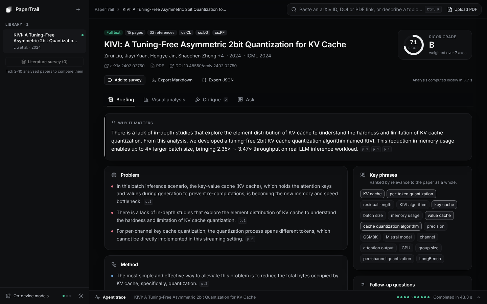
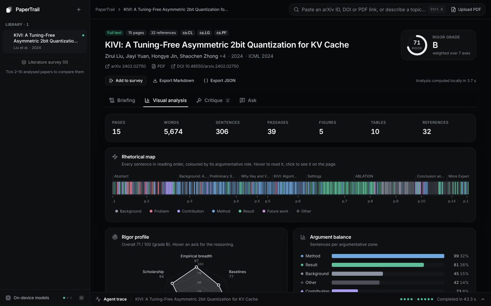
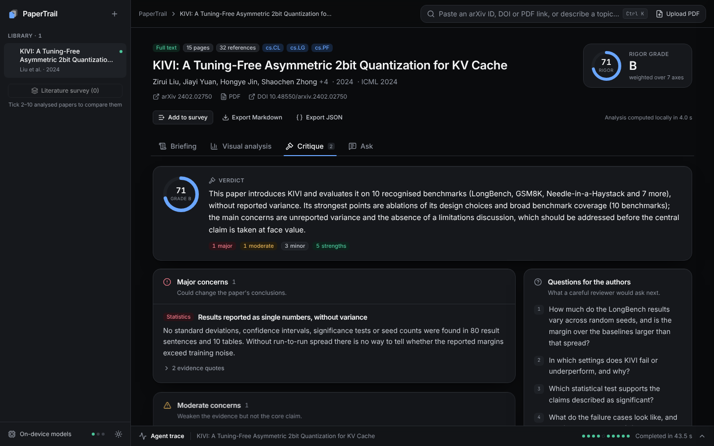
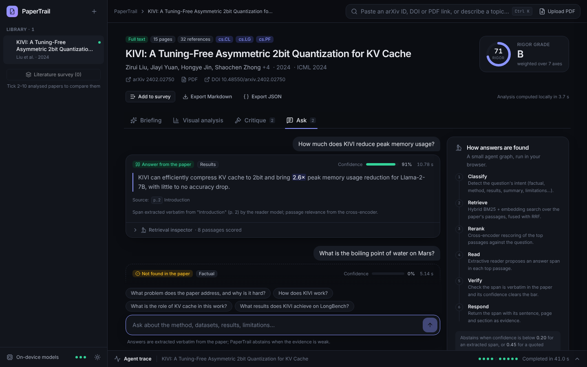
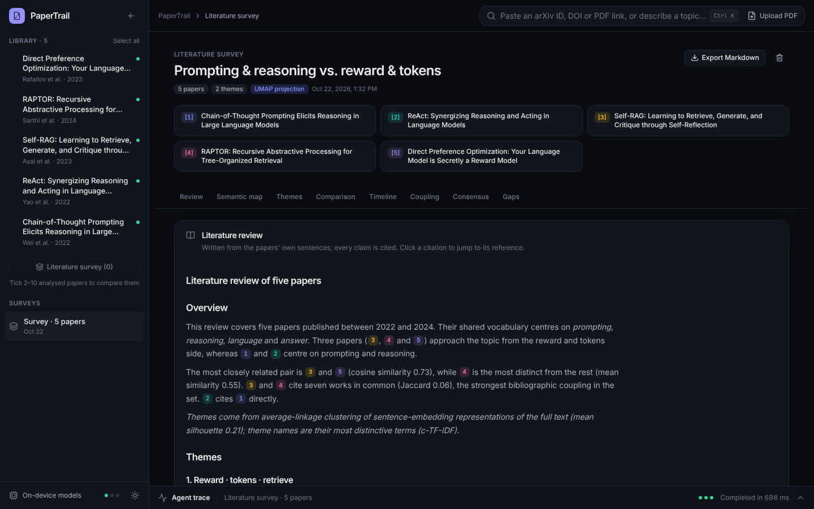
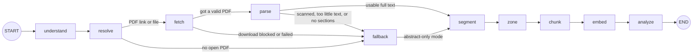
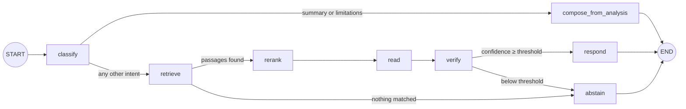

<div align="center">

# PaperTrail

**Reviewer-style analysis of research papers, computed entirely in your browser.**

[](https://github.com/Gaganpraveen/papertrail/actions/workflows/ci.yml)
[](https://github.com/Gaganpraveen/papertrail/actions/workflows/deploy.yml)
[](LICENSE)
[](https://www.typescriptlang.org/)

[**Live demo**](https://gaganpraveen.github.io/papertrail/) · [Architecture](docs/architecture.md) · [Design decisions](docs/design-decisions.md) · [Evaluation](docs/evaluation.md) · [Security](SECURITY.md)



</div>

I built PaperTrail to read a research paper the way a careful reviewer would.
You give it an arXiv ID, a DOI, a PDF link or a topic. It finds the paper, reads
the full text, and gives back a briefing, a critique, a rigor profile and a
question-answering tab. Every quote links back to its page, and every judgement
shows its evidence or says what it looked for and did not find.

It is a static site. Parsing, retrieval, the three small neural models and all
the analysis run in the visitor's browser. There is no backend, no LLM and no
API key.

## What it does

- **Finds the paper from almost any input.** arXiv IDs (new and old style, with
  or without a version), arXiv URLs, DOIs, `doi.org` links, direct PDF links, or
  a free-text topic. Publisher DOIs are matched to their arXiv preprint when one
  exists. A topic runs a search agent that retries with a broader query when
  nothing comes back.
- **Reads uploaded PDFs.** Drag a file anywhere onto the app. The file never
  leaves the machine.
- **Writes a reviewer-style briefing.** "Why it matters", problem, method, key
  results, limitations, key numbers and key phrases. Apart from the limitations
  PaperTrail flags itself, every line is a sentence from the paper, and its
  evidence chip opens the PDF page with the quote highlighted.
- **Critiques the paper.** Explicit review rules check for variance, ablations,
  baselines, benchmark breadth, code, compute, stated limitations, overclaiming,
  sample sizes and the bibliography. Each finding quotes its evidence or says
  exactly what it searched for and did not find. A 7-axis rigor profile shows
  how every score was computed.
- **Answers questions with citations, and abstains.** Answers are spans copied
  from the paper, with their sentence, section and page. When the evidence is
  too weak, PaperTrail says the paper does not answer the question and shows the
  closest passage instead.
- **Builds a literature survey of 2 to 10 papers.** Themes from clustering, a
  semantic map, a similarity matrix, a comparison matrix, bibliographic coupling,
  cross-paper consensus, open problems, and a cited literature review in
  Markdown.
- **Shows its work.** A trace dock draws the agent graph live: which node is
  running, how long each took, which route it chose, and why.

Analyses, PDFs and embeddings are saved in IndexedDB, so the library survives a
reload. A paper's analysis exports to Markdown or JSON, and a survey to
Markdown.

| Visual analysis | Critique and rigor |
| --- | --- |
|  |  |
| **Ask** | **Literature survey** |
|  |  |

## How it works

Each job is an explicit state graph. The paper pipeline turns any input into an
analysis. Failure cases are routes in the graph, not hidden `try/catch` blocks.



`resolve` looks up metadata (DataCite, with OpenAlex as a fallback, for arXiv;
Crossref, OpenAlex and Semantic Scholar for other DOIs). `fetch` streams the PDF
and checks its `%PDF-` signature. `parse` rebuilds lines, columns, sections,
references and captions.
`zone` labels each sentence's rhetorical role, `chunk` builds ~170-word
passages, `embed` encodes them with MiniLM, and `analyze` builds the briefing,
critique, rigor profile and visuals. If the embedding model fails, the run
continues with keyword retrieval and a warning.

Questions go through a second graph:



`retrieve` runs BM25 and dense search and fuses them. `rerank` re-scores the top
8 passages with a cross-encoder. `read` asks an extractive reader for a span in
each of the top 3. `verify` checks that the span appears verbatim in the paper
and that its confidence clears the bar. Yes/no and definition questions have no
span-shaped answer, so they get the best-matching sentence under a stricter
threshold.

**The graph runtime.** I wrote a small runtime for this
([`src/agent/graph.ts`](src/agent/graph.ts), about 200 lines, no dependencies).
It follows the same ideas as LangGraph: typed shared state, nodes that return
partial updates, fixed and conditional edges, and per-node retries with
exponential backoff. `compile()` rejects unknown targets and nodes with no way
out. `run()` emits a trace event for every start, end, retry, error, route and
log line. It calls `onState` with the merged state after each node, which the
store uses to update the record live, and `from` resumes a run at any node. The
topic search (`understand → search → broaden → search → rank`) and the survey
(`collect → embed → synthesize`) are built on the same runtime.
[docs/architecture.md](docs/architecture.md) walks through every graph.

## AI/ML techniques

Everything below is implemented in this repo, apart from the three pretrained
encoders, which run through transformers.js.

| Technique | Where | What it does here, and why |
| --- | --- | --- |
| BM25 (Okapi) | [`nlp/bm25.ts`](src/nlp/bm25.ts) | Keyword ranking with k1 = 1.5, b = 0.75 and Lucene's non-negative IDF. Catches exact terms a small embedding model blurs: dataset names, acronyms, "A100". |
| Sentence embeddings | [`ml/worker.ts`](src/ml/worker.ts) | `all-MiniLM-L6-v2`, 384-d, mean pooling + L2 norm, 8-bit. Used for dense retrieval, zoning, keyphrases, LexRank, survey clustering and consensus. |
| Reciprocal Rank Fusion | [`retrieval/hybrid.ts`](src/retrieval/hybrid.ts) | Fuses the BM25 and dense rankings with Σ 1/(60 + rank) over the top 100 of each. It merges ranks, not scores, so the two scales never need calibrating. Returns the top 20. |
| Cross-encoder reranking | [`qa/answer.ts`](src/qa/answer.ts) | `ms-marco-MiniLM-L-6-v2` reads (question, passage) pairs jointly for the top 8. The logit becomes a relevance with sigmoid((logit + 3) / 2), calibrated on paper passages. |
| Extractive QA with abstention | [`qa/answer.ts`](src/qa/answer.ts) | `distilbert-base-cased-distilled-squad` proposes a span in each of the top 3 passages. Confidence = relevance × reader probability × sentence support. Below 0.55 it abstains (0.45 for whole-sentence answers); a name in the question that never appears in the paper (a dataset, a model) forces an abstention. The span must match the paper verbatim. |
| LexRank | [`nlp/lexrank.ts`](src/nlp/lexrank.ts), [`analysis/briefing.ts`](src/analysis/briefing.ts) | PageRank over a sentence-similarity graph (damping 0.85). Edges need cosine ≥ 0.3 with MiniLM vectors, or ≥ 0.1 with the TF-IDF fallback. Central sentences become briefing candidates. |
| Maximal Marginal Relevance | [`nlp/mmr.ts`](src/nlp/mmr.ts) | Greedy relevance-vs-redundancy selection. λ = 0.7 for briefing bullets, 0.65 for method bullets, 0.6 for keyphrases with embeddings, 0.75 for search results. |
| KeyBERT-style keyphrases | [`nlp/keyphrases.ts`](src/nlp/keyphrases.ts) | 1–3-word noun-phrase candidates scored with a simplified YAKE. The top 48 are re-scored 50/50 by cosine to a document vector (centroid of up to 8 windows of 120 words), merged when they are near-duplicates ("KV cache" / "key-value cache"), then diversified with MMR. |
| Argumentative zoning | [`nlp/zoning.ts`](src/nlp/zoning.ts) | Labels each sentence as background, problem, contribution, method, result, limitation, future work or other. Score = 0.45 cue phrases + 0.35 cosine to prototype sentences + 0.20 section prior. Softmax at T = 0.09; confidence is the top-two margin. |
| NPMI keyphrase graph | [`analysis/visuals.ts`](src/analysis/visuals.ts) | Links two of the top 18 keyphrases when they share sentences more than chance: NPMI = log(p(a,b) / p(a)p(b)) / −log p(a,b). Keeps positive links, at most 40. |
| Agglomerative clustering + silhouette | [`survey/clustering.ts`](src/analysis/survey/clustering.ts) | Average linkage on cosine distance between paper centroids (centred on the collection mean). Tries k from 2 to min(6, n − 1) and keeps the best mean silhouette; a larger k must win by more than 0.01. |
| UMAP | [`survey/projection.ts`](src/analysis/survey/projection.ts) | 2-D semantic map of up to 40 passages per paper plus centroids. nNeighbors = min(15, n − 1), minDist = 0.1, seeded PRNG for repeatable layouts. Below 8 points, or without embeddings, it uses classical MDS. |
| c-TF-IDF | [`survey/ctfidf.ts`](src/analysis/survey/ctfidf.ts) | BERTopic's class-based TF-IDF names each theme: W(t, c) = tf(t, c) · log(1 + A / f(t)), over unigrams and bigrams. Titles count ×3 and keyphrases ×2. |
| Bibliographic coupling | [`survey/coupling.ts`](src/analysis/survey/coupling.ts) | Jaccard overlap of the works two papers cite. References are matched by arXiv ID, DOI or normalised title, joined with union-find. Also detects direct citations. |
| Cross-paper consensus | [`survey/consensus.ts`](src/analysis/survey/consensus.ts) | Result and contribution sentences from different papers that agree at cosine ≥ 0.72, grouped by star clustering so A ≈ B ≈ C cannot chain unrelated claims. |
| Rigor scoring | [`analysis/rigor.ts`](src/analysis/rigor.ts) | Counts become credit with credit(x, half) = 1 − 2^(−x / half), so the tenth ablation adds far less than the first. Seven axes, weighted: empirical 0.20, baselines 0.15, ablation 0.15, statistics 0.15, reproducibility 0.15, transparency 0.10, scholarship 0.10. Grade A ≥ 80, B ≥ 65, C ≥ 50, else D. |
| Search ranking | [`sources/rank.ts`](src/sources/rank.ts) | 0.35 BM25 + 0.40 semantic + 0.15 recency (3-year half-life) + 0.10 citation impact, then MMR. Without embeddings: 0.65 / 0.20 / 0.15. |

## Example run: KIVI (arXiv 2402.02750)

I paste `2402.02750`. The input is recognised as an arXiv ID, so the paper graph
runs. The trace dock logs one line per node:

```text
understand  arXiv paper 2402.02750
resolve     Resolved "KIVI: A Tuning-Free Asymmetric 2bit Quantization for KV Cache"
fetch       (streams the PDF from arxiv.org and reports progress)
parse       15/15 pages, 23 sections, 32 references, quality good
segment     306 sentences
zone        background 45, result 81, other 42, problem 13, contribution 23, method 99, future 2, limitation 1
chunk       39 passages
embed       Embedded 39/39 passages
analyze     Rigor 71 (B), 10 critique findings
```

**Briefing.** "Why it matters" is three sentences from the abstract (page 1),
picked by role and LexRank centrality. Only the leading "However," is
trimmed:

> There is a lack of in-depth studies that explore the element distribution of
> KV cache to understand the hardness and limitation of KV cache quantization.
> From this analysis, we developed a tuning-free 2bit KV cache quantization
> algorithm named KIVI. This reduction in memory usage enables up to 4× larger
> batch size, bringing 2.35× ∼ 3.47× throughput on real LLM inference workload.

Key numbers include **4×** (batch size), **2.35×** and **3.47×** (throughput),
**2.6×** (memory reduction) and **2%** (accuracy drop), each linked to its
sentence. The key phrases start with *KV cache*, *per-token quantization*,
*residual length*, *KIVI algorithm* and *key cache*.

**Critique.** The verdict reads:

> This paper introduces KIVI and evaluates it on 10 recognised benchmarks
> (LongBench, GSM8K, Needle-in-a-Haystack and 7 more), without reported
> variance. Its strongest points are ablations of its design choices and broad
> benchmark coverage (10 benchmarks); the main concerns are unreported variance
> and the absence of a limitations discussion, which should be addressed before
> the central claim is taken at face value.

The rigor profile shows where the 71 comes from:

| Axis | Score | Why |
| --- | ---: | --- |
| Empirical breadth | 97 | 10 benchmarks, 9 metrics, 80 result sentences |
| Baselines | 77 | 9 comparison sentences, 4 named systems |
| Ablations | 96 | 8 ablation passages and a dedicated section |
| Statistical care | 0 | no ±, std, CI, test or seed count found |
| Reproducibility | 93 | code linked, 8 hyperparameter passages, 2 compute passages |
| Transparency | 35 | no limitations section or admitted limitation; claims are well calibrated |
| Scholarship | 84 | 32 references, 94% from the 3 years before the paper |

**Ask.** Three questions, with the real outputs:

> **Q:** How much less peak memory does KIVI use?
> **A:** **2.6×** (confidence 0.96)
> *Abstract, p. 1:* "With hardware-friendly implementation, KIVI can enable
> Llama, Falcon, and Mistral models to maintain almost the same quality while
> using 2.6× less peak memory (including model weight)."

> **Q:** How should the key cache be quantized?
> **A:** **per-channel** (confidence 0.96)
> *Conclusion and Future Work, p. 9:* "We conclude that key cache should be
> quantized per-channel and value cache should be quantized per token."

> **Q:** What learning rate was used to fine-tune the model?
> **Not found in the paper.** The closest passage scored 0.02, below the 0.55
> needed to answer. KIVI is tuning-free, so this is the right call. The nearest
> passage is still shown (Settings, p. 6).

It is not perfect. Asked "What group size does KIVI use?", the reader used to
return "GSM8K" from an ablation sentence that mentions group size. Two checks now
stop that: the question asks for a quantity and "GSM8K" is not one, and the score
(0.25) is below the threshold, so PaperTrail abstains and shows that sentence as
the closest passage. When the reader is wrong with high confidence, the quoted
sentence still makes the mistake easy to spot, which is why every answer ships
with its evidence.

I produced this run with the app's own pipeline code and the same quantised
models, run in Node against the test fixture PDF. ONNX Runtime builds differ
slightly, so confidences in the browser can move in the second decimal.

## Evaluation

I measure retrieval quality, answer accuracy and abstention on labelled
questions over real papers. The method, the full results and the failure cases
are in [docs/evaluation.md](docs/evaluation.md).

**Retrieval** (39 answerable questions over 3 papers; where the passage that
holds the answer ranks):

| Retriever | Recall@1 | MRR |
| --- | --- | --- |
| BM25 only | 0.72 | 0.81 |
| Dense only | 0.46 | 0.64 |
| Hybrid (RRF) | 0.72 | 0.81 |
| Hybrid + cross-encoder | 0.82 | 0.90 |

**Question answering** (39 answerable questions, 12 that the paper doesn't
answer):

| | Answerable: correct | Answerable: wrong | Answerable: abstained | Unanswerable: false answer |
| --- | --- | --- | --- | --- |
| Shipped threshold (0.55), all 51 questions | 23/39 (59%) | 4/39 (10%) | 12/39 (31%) | 0/12 (0%) |
| Held-out estimate (chosen on two papers, tested on the third) | 23/39 (59%) | 4/39 (10%) | 12/39 (31%) | 1/12 (8%) |

How the threshold was chosen, what it costs, and every question with its answer
are in [docs/evaluation.md](docs/evaluation.md).

## Quickstart

You need Node.js 20.19 or newer.

```bash
git clone https://github.com/Gaganpraveen/papertrail.git
cd papertrail
npm install       # also copies the ONNX Runtime WebAssembly files into public/ort
npm run models    # downloads ~110 MB of quantised models once into public/models
npm run dev       # http://localhost:5173/papertrail/
```

Tests and build:

```bash
npm test          # Vitest unit and integration tests; real-model tests run when public/models exists
npm run build     # type-check and build the static site into dist/
npx playwright install chromium   # first time only
npm run test:e2e  # Playwright against `vite preview`, so build first
npm run eval      # retrieval and QA evaluation in Node; rewrites the tables in docs/evaluation.md
```

A link like `https://gaganpraveen.github.io/papertrail/#/analyze/2402.02750`
opens the app and starts the analysis directly.

## Design decisions and tradeoffs

The full reasoning is in [docs/design-decisions.md](docs/design-decisions.md).
In short:

- **Browser-only, no LLM.** It is free to run, papers stay private, and every
  output comes from an algorithm I can explain. The cost: summaries are
  extractive, the models are small, and the first visit downloads ~110 MB.
- **An explicit state graph instead of a prompt chain.** Failure handling
  (blocked download, scanned PDF, empty search, missing model) is part of the
  design, and the trace dock can draw it. LangGraph is Python, so I wrote a
  small runtime with the same ideas.
- **Hybrid retrieval with a reranker.** BM25 and dense search fail in different
  ways. RRF combines them without score calibration, and a cross-encoder
  re-scores only the top 8 because it is the slowest step.
- **Extractive answers with calibrated abstention.** A span reader cannot invent
  a fact. I chose the 0.55 threshold with leave-one-paper-out cross-validation
  on labelled questions, not by guessing.
- **A reviewer built from transparent rules.** Every finding cites a sentence or
  states what was missing, and every paper is judged by the same rules. Rules
  cannot judge novelty, so the score is a rigor profile, not a quality verdict.
- **CORS-friendly data sources.** The arXiv API sends no CORS headers, so
  metadata comes from DataCite, OpenAlex, Crossref and Semantic Scholar, and
  PDFs come straight from arxiv.org.

## Limitations and what's next

- **No synthesis.** Answers are spans or sentences. "Why" and "compare" questions
  get the best supporting sentence, not a reasoned answer. The reader can also
  be confidently wrong, as in the group-size example above.
- **PDF layout heuristics.** Standard one- and two-column papers parse well.
  Unusual layouts can lose section structure, scanned PDFs have no text layer
  (there is no OCR yet), and parsing stops at 60 pages. These cases fall back to
  an abstract-only analysis, clearly labelled.
- **Lexical review rules.** The critique sees what is written, not what is
  meant. It can tell that no variance is reported; it cannot judge whether an
  idea is new. Some heuristics are rough: evaluated models can count as
  baselines, and the self-citation check matches surnames, so common names
  inflate it (KIVI shows 38%).
- **Tuned on ML papers.** The dataset lexicon has about 290 ML datasets and
  benchmarks, and the zoning cues assume English scientific prose.
- **Single-threaded inference.** GitHub Pages cannot send the COOP/COEP headers
  that multi-threaded WebAssembly needs, so the models run on one thread.

Next, I would add OCR with tesseract.js in a worker, read arXiv's HTML version
when it exists, build a labelled set of 100+ questions to tune abstention per
question type, and try a small on-device generative model (WebGPU) that only
rephrases the extractive briefing and is checked by the same verifier.

## Project structure

```text
papertrail/
├── src/
│   ├── agent/graph.ts      state-graph runtime: nodes, edges, routers, retries, trace events
│   ├── pipeline/           the paper, topic-search and survey graphs
│   ├── sources/            input parsing, DataCite / OpenAlex / Crossref / Semantic Scholar, PDF download, ranking
│   ├── parsing/            pdf.js text -> lines and columns -> sections, references, captions
│   ├── nlp/                tokenising, BM25, TF-IDF, LexRank, MMR, keyphrases, zoning, metrics, readability
│   ├── ml/                 model registry, inference Web Worker, main-thread client
│   ├── retrieval/          section-aware chunker and hybrid BM25 + dense index
│   ├── qa/answer.ts        the question-answering graph
│   ├── analysis/           signals, briefing, critique, rigor, visuals, follow-up questions
│   │   └── survey/         clustering, projection, c-TF-IDF, coupling, consensus, gaps, narrative
│   ├── store/              zustand store, job queue, IndexedDB persistence, Markdown/JSON export
│   ├── ui/                 React views, SVG charts, trace dock, evidence drawer
│   └── types.ts            shared domain types
├── tests/                  Vitest suites and fixtures (CC BY arXiv PDFs, recorded API responses)
├── e2e/                    Playwright specs; support/network.ts serves fixtures and blocks everything else
├── eval/questions.json      labelled questions for the retrieval and QA evaluation
├── scripts/                fetch-models, copy-ort, inspect-parse, eval
├── docs/                   architecture, design decisions, evaluation, screenshots
└── .github/                ci.yml (typecheck, tests, build, e2e), deploy.yml (Pages, then live tests), dependabot.yml
```

## Security and privacy

There is no server, database, login or API key, so there is nothing on the
server side to break into or leak. Papers and analyses stay in the visitor's
browser. Paper text is always rendered as text, links from paper data must be
plain `http(s)`, and the built page ships a strict Content Security Policy.
Dependabot watches the dependencies, and CI runs with read-only permissions.
The details are in [SECURITY.md](SECURITY.md).

## Data sources and licensing

| Source | Used for |
| --- | --- |
| [DataCite](https://support.datacite.org/docs/api) | arXiv metadata (every arXiv paper has a `10.48550/arXiv.<id>` DOI) and title search |
| [OpenAlex](https://docs.openalex.org/) | Full-text search over arXiv works, citation counts, fallback metadata, open-access PDF locations |
| [Crossref](https://www.crossref.org/documentation/retrieve-metadata/rest-api/) | Metadata for publisher DOIs |
| [Semantic Scholar](https://api.semanticscholar.org/) | Hints for publisher DOIs (arXiv ID, citation count, PDF link); no retries, failures ignored |
| [arXiv](https://arxiv.org/) | Paper PDFs, downloaded by the visitor's browser from `arxiv.org/pdf/<id>` |

The arXiv API does not send CORS headers, so a web page cannot call it. I do not
use it. DataCite and OpenAlex publish their metadata under CC0. PaperTrail does
not host or redistribute papers: each browser fetches the PDF from arXiv and
keeps it locally. The PDFs in `tests/fixtures/pdfs` are arXiv papers released
under CC BY 4.0; see [the attribution file](tests/fixtures/pdfs/ATTRIBUTION.md).

## Acknowledgements

- [transformers.js](https://github.com/huggingface/transformers.js) and ONNX
  Runtime Web, which run the models in the browser.
- [pdf.js](https://github.com/mozilla/pdf.js), which extracts text and renders
  pages.
- The model authors on Hugging Face:
  [sentence-transformers/all-MiniLM-L6-v2](https://huggingface.co/sentence-transformers/all-MiniLM-L6-v2),
  [cross-encoder/ms-marco-MiniLM-L-6-v2](https://huggingface.co/cross-encoder/ms-marco-MiniLM-L-6-v2) and
  [distilbert-base-cased-distilled-squad](https://huggingface.co/distilbert/distilbert-base-cased-distilled-squad),
  used through the Xenova ONNX conversions.
- [umap-js](https://github.com/PAIR-code/umap-js), [d3-force](https://github.com/d3/d3-force),
  React, Vite, Tailwind CSS and zustand.

## License

[MIT](LICENSE) © 2026 Gagan P
