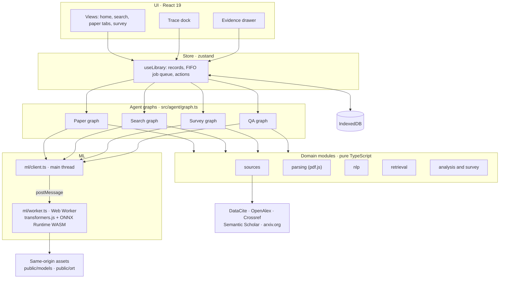
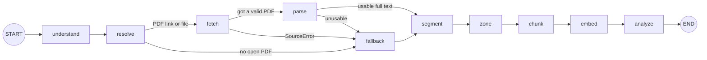
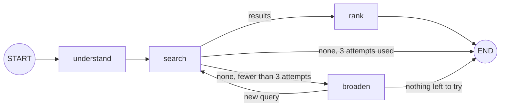
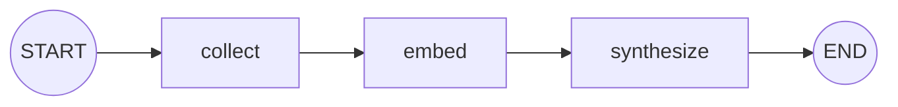
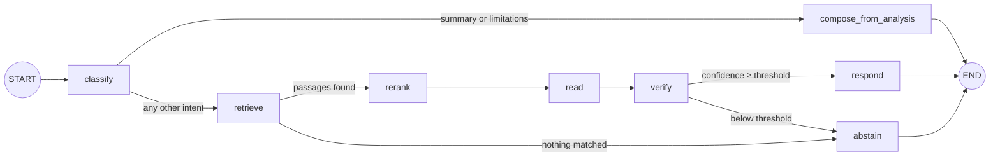

# Architecture

This page walks through how PaperTrail is put together: the layers, how an input
becomes an analysis, the graph runtime, each graph and its failure routes, the
model worker, storage, how the UI follows a run, and how I keep the end-to-end
tests deterministic.

The short version: a React UI talks to one store. The store runs agent graphs.
The graphs call pure TypeScript modules for sources, parsing, NLP, retrieval and
analysis, and call the three neural models through a Web Worker. Everything runs
in the browser, and results are saved in IndexedDB.

## 1. Layers



I kept a few rules between the layers:

- **Views never run a pipeline.** They read the store and call its actions
  (`submit`, `submitFiles`, `ask`, `runSurvey`, `retry`, …). This keeps the
  React code about rendering.
- **The store is the only caller of the graphs.** It owns the job queue, the
  caches and persistence ([`src/store/library.ts`](../src/store/library.ts)).
- **Graphs orchestrate; modules compute.** Nodes are thin. The real work lives
  in modules that have no idea they run inside a graph, so I can unit-test them
  with plain inputs.
- **Every model call goes through `ml`.** The client hides the worker, the
  caching and the failure handling behind one interface, `MLApi`.
- **Every network call goes through `sources/http.ts`.** It adds timeouts,
  retries with backoff, and typed `SourceError`s.

## 2. From input to analysis

Here is what happens when someone pastes `https://arxiv.org/abs/2402.02750v2`.

1. **Recognise the input.** `parseInput` ([`sources/input.ts`](../src/sources/input.ts))
   classifies text without any network call: arXiv ID or URL, DOI, PDF link,
   other URL, or topic. arXiv IDs are validated structurally (real month,
   4- or 5-digit serial by era, known pre-2007 archive names), so
   `2023.12345` is not mistaken for a paper.
2. **Give it a stable id.** `paperIdFor` returns `arxiv:<id>`, `doi:<doi>` or
   `url:<hash>`. Uploads use `upload:<first 12 hex of the SHA-256 of the
   bytes>`, so re-uploading the same file reuses its analysis. This id keys the
   record, the chunks, the evidence and storage.
3. **Queue it.** `submit` adds a placeholder record and pushes a job onto a FIFO
   queue with concurrency 1. One job at a time keeps the single inference
   worker and the network from being oversubscribed. A topic goes to the search
   graph instead.
4. **Run the paper graph.** Each node adds to a shared state:

   | Stage | State it adds | Shape |
   | --- | --- | --- |
   | `resolve` | `meta` | `PaperMeta`: title, authors, abstract, year, arXiv ID, DOI, `pdfUrl`, citations |
   | `fetch` | `pdf` | `ArrayBuffer`, at most 50 MB, `%PDF-` signature checked |
   | `parse` | `doc` | `ParsedDocument`: pages, sections with page ranges, references, captions, links, quality, warnings |
   | `segment` | `sentences` | `Sentence[]` with id `<sectionId>:<n>`, section and page |
   | `zone` | `sentences` | `ZonedSentence[]`: adds zone, softmax scores and confidence |
   | `chunk` | `chunks` | `Chunk[]` with id `<paperId>#<n>`, ~170 words, never crossing a section |
   | `embed` | `embeddings` | one 384-d `Float32Array` per chunk, or `null` |
   | `analyze` | `analysis` | `PaperAnalysis`: briefing, critique, rigor, visuals, stats, mode |

5. **Analyse.** Inside `analyze`, [`analyzePaper`](../src/analysis/index.ts)
   runs in a fixed order so every view shares one set of evidence:
   `extractSignals` → `buildCritique` → `buildBriefing` (which needs the
   critique for its "detected limitations") → `buildRigor` → `buildVisuals`.
6. **Save.** The store marks the record ready and writes the record, the PDF
   bytes and the chunk embeddings to IndexedDB.
7. **Ask.** The first question builds a `HybridIndex` from the stored chunks and
   embeddings and caches it. Each answer is appended to the record and saved.

## 3. The graph runtime

[`src/agent/graph.ts`](../src/agent/graph.ts) is about 200 lines with no
dependencies. I modelled it on LangGraph's ideas, because LangGraph itself is
Python and this app runs in a browser.

```ts
const graph = new StateGraph<PaperPipelineState>()
  .addNode("fetch", fetchPdf, { label: "Fetch PDF", description: "…", retries: 1 })
  .addNode("parse", parse, { label: "Parse", description: "…" })
  // …
  .addEdge(START, "understand")
  .addConditionalEdges("fetch", (s) => (s.pdf ? "parse" : "fallback"), ["parse", "fallback"])
  .addEdge("analyze", END)
  .compile();

const final = await graph.run(initialState, { onEvent, onState, signal });
```

- **Nodes** are `(state, ctx) => Partial<State>`, sync or async. They return only
  what they add, and the runtime merges it with `{ ...state, ...update }`.
  `ctx.log(message)` emits a log line for the trace, and `ctx.signal` carries the
  abort signal.
- **Edges** are fixed (`addEdge`) or chosen by a router (`addConditionalEdges`).
  A router must return one of its declared targets; anything else is an error.
  `addEdge(START, x)` sets the entry node.
- **`compile()`** validates the topology before anything runs. It needs an entry
  node, every edge and route target must exist, and every node needs a way out.
- **Retries.** A node with `retries: n` is re-run after a thrown error, waiting
  400 ms × 2^attempt between tries. When retries run out, the run throws a
  `GraphError` that names the node.
- **Trace events.** Every step emits `node:start`, `node:end` (with
  `durationMs`), `node:retry`, `node:error`, `route` (with `to`) or `log`. Each
  event carries a timestamp.
- **`onState`** is called with the merged state after every node, and `from`
  starts a run at any node, so a caller can checkpoint and resume.
- **Safety.** The run checks the abort signal before each node and stops after
  `maxSteps` (64 by default), so a bad router cannot loop forever.
- **`describe()`** returns the nodes and edges, which is enough to draw the
  graph.

## 4. The graphs

### 4.1 Paper graph

[`src/pipeline/paper.ts`](../src/pipeline/paper.ts)



| Node | What it does | When something goes wrong |
| --- | --- | --- |
| `understand` | Logs what the input is. | A topic or an upload without a file is an error: topics belong to the search graph. |
| `resolve` | Metadata from DataCite (OpenAlex as fallback) for arXiv; Crossref, OpenAlex and Semantic Scholar for other DOIs, preferring an arXiv copy; the file name for uploads and bare links. The lookup is skipped when the metadata came from a search result. | If the arXiv indexes are unreachable, it continues with a placeholder record that points at the arXiv PDF and adds a warning. The PDF carries the title and abstract. |
| `fetch` (1 retry) | Streams the PDF with progress, enforces the 50 MB cap and checks the `%PDF-` signature. Uploads are already in memory. | A `SourceError` (CORS, 404, timeout, not a PDF, too large) is recorded as `fetchError` and routed to `fallback`. Anything unexpected is retried once by the runtime. |
| `parse` | pdf.js text → lines and columns → sections, references, captions, links. Up to 60 pages. Fills the title and abstract for uploads. | A parse exception, an image-only PDF (fewer than 80 characters per page on average), fewer than 1,500 characters of text, or no recoverable sections routes to `fallback`. |
| `fallback` | Switches to abstract-only mode with a clear warning. | With no abstract either, the run fails with a next step: "No arXiv paper found for …", or "upload the PDF". |
| `segment` | Splits sections into sentences, skips references and acknowledgments, drops table and equation residue, and finds each sentence's page. | No readable sentences is an error. |
| `zone` | Argumentative zoning of every sentence. | If the embedder fails, it zones with cue phrases and section priors only, and adds a warning. |
| `chunk` | ~170-word passages (max 260) with one sentence of overlap, never crossing a section. | – |
| `embed` | MiniLM vectors for every chunk, 32 per request. | On failure, `embeddings` is `null`, retrieval becomes BM25-only, and the warning "Semantic search unavailable, using keyword retrieval." is shown. |
| `analyze` | Signals, critique, briefing, rigor, visuals. | The embedder is passed on only if `embed` worked. Otherwise LexRank uses TF-IDF vectors and keyphrases use their statistical score alone. |

The three routers are short enough to read in full:

```ts
routeAfterResolve = (s) => (s.pdf || s.file || s.meta?.pdfUrl ? "fetch" : "fallback");
routeAfterFetch   = (s) => (s.pdf ? "parse" : "fallback");
routeAfterParse   = (s) => (s.doc && !unusableReason(s.doc) ? "segment" : "fallback");
```

Below the graph, `fetchWithRetry` handles transient HTTP failures: 429, 408,
5xx, timeouts and dropped connections are retried twice with "equal jitter"
backoff (base 500 ms, cap 8 s), and a `Retry-After` header wins when it is
under 10 s. 404s and other 4xx errors fail fast. So when `fetch` sees a
`SourceError`, retrying again would not help, and routing to the fallback is
the right move.

### 4.2 Topic search graph

[`src/pipeline/search.ts`](../src/pipeline/search.ts)



- `search` queries DataCite (title search over arXiv DOIs) and OpenAlex
  (full-text search over works hosted on arXiv) in parallel, 25 results each,
  and merges them on the arXiv ID. It only fails when both indexes fail.
- `broaden` is the self-correcting step. First it strips conversational filler
  ("recent papers about …"). Then it keeps only the two or three most specific
  terms. It never repeats a query already tried.
- `rank` scores each candidate as 0.35 BM25 + 0.40 semantic + 0.15 recency +
  0.10 impact, then reorders with MMR (λ = 0.75) and returns the top 20.
  Without the embedder it uses 0.65 / 0.20 / 0.15. Every candidate carries its
  four sub-scores and a one-line reason, which the search view shows as bars.

### 4.3 Survey graph

[`src/pipeline/survey.ts`](../src/pipeline/survey.ts)



- `collect` removes duplicates and needs at least 2 analysed papers. The store
  caps the selection at 10.
- `embed` reuses the cached chunk embeddings and computes any that are missing.
  If the model fails, every paper switches to TF-IDF vectors. Mixing embedding
  and TF-IDF vectors would make the papers incomparable.
- `synthesize` runs [`buildSurvey`](../src/analysis/survey/index.ts), and each
  step reports progress into the trace:
  1. Represent each paper as the mean of its chunk vectors.
  2. Cluster the papers into themes: average linkage, with k chosen by
     silhouette. With 3 or more papers, embedding centroids are first centred
     on the collection mean, because papers from one field share a large
     common component that squeezes every cosine into a narrow band.
  3. Name the themes with c-TF-IDF.
  4. Project up to 40 passages per paper, plus centroids, onto a 2-D map with
     UMAP (MDS below 8 points).
  5. Measure bibliographic coupling and direct citations.
  6. Find consensus statements and open problems from zoned sentences. Shared
     critique weaknesses count as a gap when at least half the papers have
     them.
  7. Build the comparison matrix and write the cited Markdown review.

### 4.4 Question-answering graph

[`src/qa/answer.ts`](../src/qa/answer.ts)



| Node | What it does |
| --- | --- |
| `classify` | Regex rules map the question to an intent: limitations, summary, comparison, results, method, or factual. |
| `compose_from_analysis` | Overview questions are answered from the briefing: the TL;DR plus two method and two result bullets, or the author-stated and flagged limitations. Its confidence is the share of lines backed by quoted evidence. |
| `retrieve` | Hybrid search over the chunks, skipping references and acknowledgments. It returns 20 hits and gives a 5% boost to sections that suit the intent (method → method sections, results → results and experiments, …). |
| `rerank` | The cross-encoder scores the top 8. Relevance = sigmoid((logit + 3) / 2). |
| `read` | The reader proposes a span in each of the top 3 passages. Yes/no, definition and (without an analysis) overview questions use the best-matching sentence instead. |
| `verify` | The span must occur verbatim in its chunk. `alignSpan` repairs tokenizer spacing ("2. 6 ×" → "2.6×"), and spans that run past a sentence end are trimmed. Support = 0.5 + 0.5 × how well the span's sentence matches the question. Confidence = relevance × reader probability × support. |
| `respond` | Returns the span, its full sentence as context, the section, the page and the scored hits. |
| `abstain` | Returns "The paper does not appear to answer this question", the score it got, and the closest passage as evidence. |

Span answers need 0.20 and sentence answers need 0.45. Every model is optional
here. Without the reranker, relevance comes from IDF-weighted term coverage
blended with embedding similarity. Without the reader, the best sentence is
quoted. Each fallback adds a note to the answer's explanation, so the reader of
the answer knows what was missing.

## 5. The ML worker

The three models run in a module Web Worker, so parsing and the UI stay
responsive while a paper is embedded.

| Key | Model | Task | Size (q8) |
| --- | --- | --- | ---: |
| `embedder` | `Xenova/all-MiniLM-L6-v2` | feature extraction, 384-d | 23 MB |
| `reranker` | `Xenova/ms-marco-MiniLM-L-6-v2` | cross-encoder (sequence classification) | 23 MB |
| `reader` | `Xenova/distilbert-base-cased-distilled-squad` | extractive question answering | 64 MB |

**Protocol** ([`ml/models.ts`](../src/ml/models.ts)). The client posts
`{ id, type, payload }`, where `type` is `embed`, `rerank`, `answer` or `warmup`.
The worker replies with `{ id, ok: true, result }` or
`{ id, ok: false, error, key }`. Separately, it streams
`{ type: "status", key, status }` messages with `idle`, `loading` (with
progress), `ready` or `error`. The client matches replies to pending promises
by id.

**Inside the worker** ([`ml/worker.ts`](../src/ml/worker.ts)):

- Each model loads lazily on first use and stays loaded. A failed load is
  forgotten, so a later call can retry.
- Download progress is summed across a model's files and sent at most once per
  whole percent.
- Embeddings use mean pooling and L2 normalisation, 16 texts per forward pass.
  The resulting `Float32Array` buffers are transferred, not copied.
- The reranker loads a tokenizer and a sequence-classification model directly.
  Each (question, passage) pair gives one logit.
- The reader uses the question-answering pipeline. That pipeline returns
  re-spaced text without offsets, so `alignSpan` finds the span in the original
  context and the answer quotes the paper's exact characters.
- Models load from `public/models` on the same origin, with the Hugging Face
  Hub as a fallback when a file is missing. ONNX Runtime's WebAssembly files
  load from `public/ort`. Inference uses one thread, because GitHub Pages
  cannot send the COOP/COEP headers that `SharedArrayBuffer` needs.

**On the main thread** ([`ml/client.ts`](../src/ml/client.ts)):

- The worker is spawned on the first call, so a page that never needs a model
  never downloads one.
- `embed` has a 4,096-entry LRU cache keyed by text (about 6 MB of vectors), and
  removes duplicates before sending. Zoning embeds every sentence, so the
  briefing's LexRank later gets the same vectors from the cache for free.
- Every failure becomes an `MLUnavailableError`, which callers treat as
  "continue without this model".
- After a model fails, calls to it fail fast for 30 seconds instead of
  re-downloading on every request. An explicit `warmup` always retries.
- If the worker crashes, every pending call is rejected and models that were
  loading are marked as failed.
- `subscribe` lets the UI show each model's status in the sidebar.

## 6. Storage

Everything stays on the visitor's machine
([`store/db.ts`](../src/store/db.ts)). I use one IndexedDB store (database
`papertrail`, store `kv`, through idb-keyval) with prefixed keys:

| Key | Value |
| --- | --- |
| `paper:<id>` | `PaperRecord` (metadata, analysis, sentences, chunks, Q&A history), without its live trace |
| `pdf:<id>` | the raw PDF bytes, for page previews in the evidence drawer |
| `emb:<id>` | chunk embeddings packed into one `Float32Array` buffer (`{ count, dim, data }`) |
| `survey:<id>` | `SurveyRecord`, without its live trace |

- Packing embeddings into one buffer stores one value per paper instead of
  hundreds of small ones.
- If IndexedDB is missing (some private modes) or a write fails (quota), storage
  switches to an in-memory map. The session keeps working; it just will not
  survive a reload.
- On load, `hydrate` restores papers and surveys. A run cannot survive a reload,
  so anything still queued or running is shown as "Interrupted by a page
  reload" with a retry button.
- Embeddings and retrieval indexes are loaded lazily, the first time a question
  is asked or a survey runs, and then cached in memory.
- `localStorage` holds only small UI preferences: the theme and whether the
  trace dock is open.

## 7. How the UI follows a run

Traces flow one way: graph → store → UI.

1. **The graph emits events.** The store passes an `onEvent` callback to
   `run()`. For paper jobs, `onTrace(id)` appends each event to the record's
   `trace`, sets `currentNode` on `node:start`, and moves progress forward as
   completed nodes / 9 (the length of the full-text path), capped at 97% until
   the record is actually ready.
2. **State updates show early.** `onState` copies `meta`, `mode` and `warnings`
   into the record after every node. The sidebar shows the real title as soon
   as `resolve` finishes, long before the analysis is done.
3. **The dock picks a job.** `useActiveJob` chooses what to show: the paper,
   survey or search behind the current view, or, on the home screen, the paper
   being analysed right now. Each job type brings its node list
   (`PAPER_NODES`, `SEARCH_NODES`, `SURVEY_NODES`).
4. **Events become node states.** `deriveNodes` in
   [`ui/trace/traceModel.ts`](../src/ui/trace/traceModel.ts) replays the events
   in order. Each node gets a status (pending, running, done, failed or
   skipped), a total duration, a visit count and a retry count. Durations add up
   across visits, so the search loop shows `Search ×2`. A node that never
   started is "pending" while the run is live and "skipped" once it ends, which
   is exactly how a skipped `fallback`, or a skipped `fetch` and `parse`,
   shows up.
5. **The dock draws it.** [`TraceDock`](../src/ui/trace/TraceDock.tsx) draws the
   nodes as pills joined by connectors, lists the routes taken, and shows an
   event log with relative timestamps. A running job also gets a live elapsed
   timer.

Questions are short, so they do not use the dock. `answerQuestion` collects
each node's duration into `answer.timingsMs`, and the Ask tab shows them under
each answer, next to a "How answers are found" panel built from `QA_NODES`.

## 8. Deterministic end-to-end tests

The Playwright suite drives the real built app against `vite preview` on
`127.0.0.1:4317/papertrail/`, in Chromium, with one worker. It never touches
the internet. [`e2e/support/network.ts`](../e2e/support/network.ts) intercepts
every request:

1. **Block everything off-origin.** A catch-all route aborts any request that is
   not for `127.0.0.1` or `localhost`, and logs it. Playwright runs the most
   recently registered matching route first, so this goes in first and the
   specific routes below override it.
2. **Serve arXiv PDFs from fixtures.** `arxiv.org/pdf/<id>` returns
   `tests/fixtures/pdfs/<id>.pdf` (or a file from `PAPERTRAIL_SAMPLES` when that
   variable is set). Unknown IDs get a 404, which exercises the abstract-only
   fallback.
3. **Serve API responses from recordings.** DataCite single-DOI lookups map to
   `tests/fixtures/api/datacite/<id>.json`, and searches pick a recorded
   response by keyword (or an empty result). OpenAlex and Crossref return
   recorded responses for the KV-cache search and the BERT DOI. Anything else
   gets an empty result or a 404.

Two things follow from this design:

- **Self-hosting is proven.** Hugging Face, CDNs and Semantic Scholar are all
  blocked, so the models and the ONNX runtime must load from the app's own
  origin. The main paper spec asserts that the blocked list is empty, which
  means the app did not even try to reach anything it should not.
- **Errors are checked.** `watchErrors` collects uncaught exceptions and console
  errors (ignoring the expected blocked requests and fixture 404s), and specs
  assert there were none.

The specs cover the home screen, theme and mobile layout, topic search with
abstract-only fallback, DOI → arXiv resolution, PDF upload, an unknown arXiv
ID, the full KIVI flow (briefing, visuals, critique, a cited answer, an
abstention, the evidence drawer, persistence across reload), and the
five-paper survey sample. Setting `PAPERTRAIL_SHOTS=<dir>` saves a screenshot
of each step; that is how I make the images in `docs/assets`.

The Vitest suites never use the network either. Source adapters are tested
against recorded API responses, and parsing and analysis against real CC BY
arXiv PDFs. The real-model tests load the quantised models from `public/models`
in Node and are skipped when the models are not downloaded.
