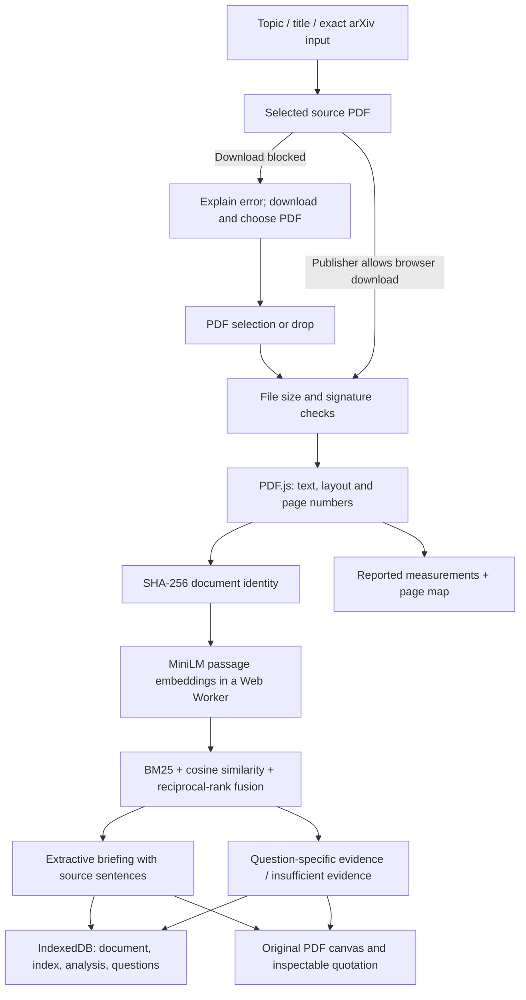

# Browser application

The browser edition is a static web application designed for GitHub Pages. The visitor's device runs PDF parsing and neural retrieval. No Python server, Ollama service, API key, paid generation provider or shared session store is required. The original Python application remains available for local generative RAG.

## Run

Use Node.js 24 and pnpm 11.25.0:

```sh
npm install --global pnpm@11.25.0
pnpm --dir web install --frozen-lockfile --ignore-scripts
pnpm --dir web dev
```

Open http://127.0.0.1:5173. For the production build:

```sh
pnpm --dir web check
pnpm --dir web test
pnpm --dir web build
pnpm --dir web preview
```

The build downloads an unchanged, openly licensed sample PDF and checks its SHA-256. Attribution is in `web/public/samples/ATTRIBUTION.txt`. No uploaded document is included in the build. Dependencies and the embedding model revision are pinned. Native dependency install scripts are unnecessary for browser inference and are disabled.

## Reading workflow

1. Choose or drop a text-readable PDF, or use **Try a sample paper**. The sample performs fresh analysis, not a saved response.
2. Inspect the briefing. Each quotation links to its PDF page and full passage.
3. Ask a focused question in **Ask the paper**. **Findings** shows a page text map and measurements with source context. **Related work** searches scholarly metadata.

Title/topic search uses OpenAlex and asks the reader to select a result. Exact arXiv IDs and URLs preserve the requested version in the source and PDF URLs. Direct PDF downloads depend on publisher CORS permission. If blocked, open the source, download the PDF, then choose it locally. No alternate paper is silently substituted. This fallback is a limitation of a static, browser-only deployment.

## Logic map



`web/src/pdf.js` manages PDF.js; `layout.js` reconstructs reading order; `analysis.js` contains chunking, BM25, rank fusion, sentence selection and measurement rules. `ml.worker.js` runs quantized `Xenova/all-MiniLM-L6-v2` through Transformers.js/ONNX Runtime WASM. `storage.js` isolates documents by content identity. `main.js` manages navigation, operation cancellation, citations and charts. Vite bundles the application; GitHub Actions tests and builds it before Pages deployment.

## Design decisions and boundaries

- **Extractive output:** briefings and answers contain selected source wording, not LLM-generated explanations. This makes provenance inspectable and removes generation costs, but cannot provide the depth or fluent synthesis of the Python/Ollama edition. It is neural retrieval with extractive answering, not generative RAG.
- **On-device storage:** PDFs and questions stay in that browser's IndexedDB. Clearing site data removes them. There is no account, cross-device sync or cloud backup. Search queries go to OpenAlex, model files come from Hugging Face, and interface fonts come from Google Fonts.
- **Conservative evidence selection:** lexical overlap and semantic similarity gate answers. A missing match produces an abstention. These heuristics can still miss answers or select tangential quotations; provenance does not establish entailment or scientific validity. Earlier generated answers are never retrieval evidence.
- **Bounded operations:** 30 MiB, 100 pages, 1,600 passages and a three-minute processing deadline. Cancel terminates the model worker and PDF task. Failed or interrupted processing restarts; completed analyses reopen from storage. Rebuild explicitly replaces the selected document's analysis and questions.
- **Measurements are observations:** charts show values extracted from prose, with source pages. Different units cannot share a comparison chart. Matching units alone do not establish comparable tasks, datasets or experimental settings. No independent reproduction, automatic cross-paper fact checking or fabricated benchmarks.
- English, readable research PDFs work best. No OCR. Scans, encryption and corrupt PDFs are rejected. Complex figures, tables, equations, columns and unusual typography can still damage extraction. Browser performance and storage quotas vary. Initial model/WASM downloads require a network connection.

## Verification record

Checks below are observations on one local machine, not controlled performance benchmarks. Model file cache reuse is distinct from reusing a saved analysis.

- Browser file-picker upload of Breiman's *Random Forests* succeeded. Fresh analysis initially took 17.8 s; after sentence and layout corrections, a rebuild of the same source took 11.8 s with cached model files. These runs used different chunking and are not a controlled speed comparison.
- “What class do the trees vote for?” retrieved the exact page-2 voting passage; its citation opened page 2. “What was the total research budget in US dollars?” abstained. Both displayed less than 0.1 s after model warmup.
- Live topic query `retrieval augmented generation` returned relevant OpenAlex results. Importing *Active Retrieval Augmented Generation* from its publisher was blocked by browser CORS. The application showed the manual-download fallback and preserved the selected result.
- The first production sample run exposed mixed columns below a figure. A layout regression now covers independent column baselines; source extraction was corrected before release.
- Repeated file-picker automation later failed in the browser controller. Malformed upload, native drag-and-drop, encrypted/scanned-file rejection and automatic deadline expiry have not been verified through the browser in this release. The existing Python upload tests do not verify the separate browser implementation.
- Automated checks: 12 browser logic tests; 224 Python regression tests passed in 26.88 s. Python lint/format and browser formatting/build passed. Python server tests require loopback socket permission; the first sandboxed attempt failed during server setup and the permitted rerun passed.

## Deployment

`.github/workflows/browser.yml` builds on pushes and pull requests. Deployment runs only from `main`. In repository Settings → Pages, choose **GitHub Actions** as the source. The expected application URL is https://gaganpraveen.github.io/papertrail/. A workflow file or local preview alone does not establish a successful public deployment; check the Actions deployment result.

Historical reports in `docs/index.html` and `examples/` remain saved examples. They are not the browser application's runtime or evidence of fresh processing.

Final production-build sample check: *Active Retrieval Augmented Generation*, 24 pages, SHA-256 prefix `5536c9136a51`, completed fresh parsing/indexing/briefing in **14.680 s**, with model files cached. The briefing included the proposed FLARE method and page-9 negative results on Wizard of Wikipedia/ELI5. “When does FLARE retrieve information?” returned source passages in **0.020 s**; the page-3 citation opened the original PDF. The research-budget question abstained in **0.021 s**. These are browser-reported operation times, not independent latency benchmarks. The first retrieved quotation was tangential to the timing question, so evidence ranking remains imperfect even when another retrieved passage answers it.
